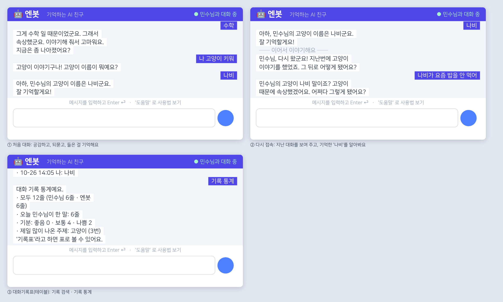

# 엔봇 — 기억하는 AI 친구 (엔트리 블록 코딩 챗봇)

[엔트리(playentry.org)](https://playentry.org)에서 불러와 바로 실행할 수 있는 블록 코딩 챗봇 작품입니다.
정해 둔 문장을 돌려주지 않고, **사용자의 문장을 분석해서** 공감하고, 되묻고, 들은 내용을 기억합니다.
기억은 엔트리 계정마다 따로 저장되어, 다시 접속하면 지난 이야기를 이어 갑니다.

- 작품 파일: [`entry-ai-chatbot.ent`](entry-ai-chatbot.ent)
- 오브젝트 24개 (모두 글상자) · **함수 41개** · **테이블 6개** · 블록 약 10,600개



> 위 그림은 실제 엔트리 화면을 캡처한 것이 아닙니다. 시뮬레이터로 대화를 돌린 뒤, 작품 파일 속 글상자 설정(위치·정렬·색)대로
> 다시 그린 미리보기입니다 (`preview.py`). 글꼴과 입력창 모양은 실제와 조금 다를 수 있습니다.

## 이번 버전에서 바뀐 것

| | 이전 | 지금 |
| --- | --- | --- |
| 코드 구조 | 숨은 오브젝트 3개에 신호로 나눈 스크립트 | **엔트리 함수 41개** (값을 돌려주는 함수 13개 + 일반 함수 28개) |
| 블록 수 | 10,623개 | **10,594개** (기능과 데이터가 늘었는데도 조금 줄었음) |
| 함수 없이 같은 동작을 만들면 | — | 약 36,000개 → 함수 덕분에 **약 3.4배 짧음** |
| 지식 데이터 | 리스트 항목 334개 | **테이블 5개, 1,244줄** (아래 표) |
| 상황별 문장 | 97개 | 146개 (53종류) |
| 대화 기록 | 서버에 글 한 덩어리 | **`대화기록표` 테이블**: 번호·날짜·시각·누가·주제·감정·내용 + 검색·통계 |
| 대답 속도 (부스트 모드 끔, 같은 대화 15번) | 평균 81프레임 (약 1.3초) | **평균 24프레임 (약 0.4초)** |
| 안전 | — | 개인정보는 기억·기록하지 않음, 위기 신호에는 상담 전화 안내 |

대답이 빨라진 까닭: 예전에는 리스트를 처음부터 끝까지 훑었는데, 지금은 말 속의 조각을 테이블에서 **VLOOKUP**으로 바로 찾습니다.
그래서 데이터를 수천 줄로 늘려도 속도가 그대로입니다.

### 함수

화면 오브젝트 `엔봇`의 메인 스크립트는 `데이터 불러오기` → (묻고 기다리기 → `답변 만들기` → `기록하기` → `기록 저장`) 반복이 전부이고,
나머지는 모두 함수입니다.

| 묶음 | 함수 |
| --- | --- |
| 글자 다루기 (값) | `앞뒤 공백 지우기` `앞 글자 떼기` `뒤 글자 떼기` `끝 글자` `두 자리 숫자` `조사 붙이기` `조사 떼기` `대답 다듬기` `계산` |
| 생각하기 | `문장 분석` `감정 점수 찾기`(값) `기억 연결` `사실 찾기` `좋아하는 것 찾기`(좋아/싫어 하나로) `주제 질문`(값) `문장 완성`(값) |
| 대답 만들기 | `답변 만들기` → `대답: 명령` → `대답: 물어본 것의 대답` → `대답: 기억` → `대답: 뜻과 일상 대화` → `대답: 감정과 주제` → `대답: 이어 가기` |
| 기억 | `사실 저장` `기억에서 찾기` `기억 꺼내기` `키 보여 주기`(값) `먼저 물을 질문 붙이기` |
| 기록표 | `기록하기` `기록표에 줄 넣기` `기록 줄 풀기` `기록 검색` `기록 통계` `기록표 비우기` |
| 서버 저장 | `데이터 불러오기` `기록 저장` `기억 저장` `내 기록 칸 찾기` `내 기억 칸 찾기` |
| 화면 | `말풍선 출력` `상태 표시` |

값을 돌려주는 함수에는 반복 블록을 넣지 않았습니다. 엔트리에서 값 함수 안에 반복이 있으면 여러 프레임에 걸쳐 계산되어
값이 늦게 나오기 때문입니다 (테스트로 검사합니다).

### 테이블 (지식 + 대화 기록)

| 테이블 | 줄 수 | 쓰는 곳 | 원본 파일 |
| --- | ---: | --- | --- |
| `표-주제` | 395 | 주제 낱말 → 이어서 물을 말 | `knowledge/주제.csv` |
| `표-단어뜻` | 351 | "○○가 뭐야/누구야?" → 뜻 (분류: 컴퓨터·과학·우주·수학·국어·역사·인물·사회·지리·마음…) | `knowledge/단어뜻.csv` |
| `표-일상대화` | 180 (대답 212개) | 키워드 → 대답 (수수께끼·퀴즈·아재개그·추천·인사·공부법…) | `knowledge/일상대화.csv` |
| `표-감정어` | 276 | 낱말(앞 2~4글자) → 감정 점수 | `knowledge/감정어.csv` |
| `표-먼저묻기` | 42 | 아직 모르는 것을 먼저 물어볼 질문 | `knowledge/먼저묻기.csv` |
| `대화기록표` | 실행 중 채워짐 | 번호·날짜·시각·누가·주제·감정·내용 | — |

- 시작하면 서버(실시간 리스트)에 저장된 내 대화를 읽어 `대화기록표`를 다시 채웁니다. 대화할 때마다 한 줄씩 늘어납니다.
- 데이터를 고치려면 엔트리의 **테이블 탭**에서 직접 고치거나, CSV를 고친 뒤 `python3 build_project.py`로 다시 만들면 됩니다.

### 대화 기록 명령

| 명령 | 하는 일 |
| --- | --- |
| `기록표` | `대화기록표` 창을 엽니다 (엔트리 테이블 보기) |
| `기록 검색: 나비` | '나비'가 들어간 줄을 **최근 것부터** 5개 보여 줍니다 |
| `기록 통계` | 전체 줄 수, 내 말/엔봇 말, 오늘 한 말, 기분(좋음·보통·나쁨), 가장 많이 나온 주제 |
| `새 대화` | 화면·서버 기록·기록표를 비웁니다 (기억은 그대로) |

## 꼭 알려 드릴 점: 구글 스프레드시트와 보안

**구글 스프레드시트 연결은 보안 기능이 아닙니다.** 엔트리 소스(entryjs, @entrylabs/tool)에서 확인한 내용입니다.

1. **불러오기만 됩니다.** 엔트리 테이블은 구글 시트에서 표를 *가져올* 수는 있지만, 작품이 실행 중에 시트로 *저장*하지는 않습니다.
   가져올 때도 `docs.google.com/spreadsheets/d/…/gviz/tq?tqx=out:csv` 형태의 공개 CSV 주소를 씁니다.
2. **시트가 공개되어 있어야 합니다.** 링크가 있는 사람 누구나 볼 수 있는 시트여야 불러올 수 있으므로,
   비밀 정보를 시트에 두면 오히려 더 많이 드러납니다.
3. **테이블은 실행이 끝나면 처음 상태로 돌아갑니다.** 실행 중에 바뀐 테이블 내용은 서버에 저장되지 않습니다.
   그래서 엔봇은 `대화기록표`를 보여 주기·검색·통계용으로 쓰고, 실제 저장은 계정별 **실시간 리스트**(`대화기록`, `기억저장소`)에 합니다.
   다시 실행하면 이 리스트에서 기록표를 다시 채웁니다.
4. **작품에 들어 있는 테이블과 리스트는 코드를 보는 사람이 볼 수 있습니다.** 실시간 리스트도 모든 사용자의 칸이
   `아이디|내용` 형태로 한 리스트에 들어갑니다. 완전한 비공개 저장소가 아닙니다.

그래서 엔봇은 이렇게 합니다.

- `비밀번호`, `전화번호`, `주소`, `계좌` 같은 말이 들어가면 **기억하지 않고**, 서버 기록과 기록표에도
  `🔒 (개인정보라서 기록하지 않았어요)`로만 남깁니다. `기억해:` 명령으로도 저장되지 않습니다.
- "죽고 싶어" 같은 위기 신호에는 다른 대답보다 먼저 **청소년상담 1388, 자살예방상담 109**를 안내합니다.
- 작품 설명에 **"개인정보는 입력하지 마세요"** 라고 꼭 적어 주세요.

## 실제 대화 예시

아래는 작품의 블록을 그대로 실행하는 시뮬레이터(`simulate.py`)로 얻은 대화입니다.

```
나: 오늘 시험 망쳤어
봇: 오늘 시험 망쳤군요. 속상한 마음 충분히 이해해요. 어떤 과목 시험이었어요?
나: 수학 시험이었어
봇: 수학 시험이었군요. 그런 일이면 누구라도 힘들었을 거예요. 오늘은 맛있는 거 먹고 푹 쉬어요. 내일은 더 나을 거예요.
나: 나 고양이 키워
봇: 고양이 이야기구나! 고양이 이름이 뭐예요?
나: 나비
봇: 아하, 민수님의 고양이 이름은 나비군요. 잘 기억할게요!
나: 장영실이 누구야?
봇: 장영실은 조선 세종 때의 과학자예요. 해시계, 물시계, 측우기를 만들었어요.
나: 양자컴퓨터가 뭐야?
봇: 양자컴퓨터? 처음 들어 봐요. 어떤 건지 알려 줄래요?
나: 양자의 원리로 계산하는 컴퓨터야
봇: 오, 양자컴퓨터는 양자의 원리로 계산하는 컴퓨터군요. 기억해 둘게요!
나: 내 비밀번호는 1234야
봇: 그건 비밀번호나 전화번호 같은 중요한 개인정보 같아요. 저는 기억하지 않을게요. 🔒 다른 사람에게도 함부로 알려 주지 마세요!
나: 기록 검색: 나비
봇: '나비' 기록을 2개 찾았어요. (최근 것부터 5개까지)
    · 10-26 14:05 봇: 아하, 민수님의 고양이 이름은 나비군요. 잘 기억할게요!
    · 10-26 14:05 나: 나비
나: 기록 통계
봇: 대화 기록 통계예요.
    · 모두 18줄 (민수님 9줄 · 엔봇 9줄)
    · 오늘 민수님이 한 말: 9줄
    · 기분: 좋음 0 · 보통 8 · 나쁨 1
    · 제일 많이 나온 주제: 시험 (2번)
```

다음 날 다시 접속하면 지난 대화가 다시 보이고(`── 지난 대화 ──`), 기록표도 다시 채워집니다.

```
봇: 민수님, 다시 왔군요! 지난번에 고양이 이야기를 했었죠. 그 뒤로 어떻게 됐어요?
나: 나비가 요즘 밥을 안 먹어
봇: 민수님의 고양이 나비 말이죠? 고양이 때문에 힘들었군요. 무슨 일이 있었는지 조금 더 말해 줄래요?
나: 양자컴퓨터 알아?
봇: 제 기억으로는 양자컴퓨터는 양자의 원리로 계산하는 컴퓨터예요.
```

## 엔봇이 생각하는 방법

`답변 만들기` 함수가 아래 순서로 대답을 정합니다. 먼저 정해진 쪽이 대답이 됩니다.

1. **문장 분석**: 낱말로 나누고 조사를 떼어 냅니다 (`조사 떼기`: '발표했어'·'수학이야'처럼 주제 낱말 뒤에 붙은
   '하다·이다'도 뗍니다). 주제를 찾고, 질문인지 판단하고, `감정 점수 찾기`로 낱말마다 점수를 더합니다
   ('안 좋아'처럼 앞에 안/못이 오면 뒤집습니다). "시험 망쳤어" → "시험 망쳤군요"처럼 되받을 말도 만듭니다.
2. **명령**: 위기 신호, 도움말, `기억해:`, `잊어줘:`, 번역, 계산, 기록 명령.
3. **물어본 것의 대답**: 직전에 고양이 이름을 물었으면 다음 대답을 '내 고양이 이름'으로 저장합니다.
   이야기 속 사실("내 생일은 3월 14일이야", "나 피자 좋아해", "나 12살이야")도 여기서 기억합니다.
4. **기억**: "내 생일 언제라고 했지?", "나에 대해 알아?", 기억해 둔 값이 말 속에 나오면 알아봅니다 ("나비" → 고양이).
5. **뜻과 일상 대화**: `표-단어뜻`, 시간·날짜, `표-일상대화`. 모르는 단어와 질문은 물어보고 배웁니다.
6. **감정과 주제**: 걱정 → 응원, 부정 → 공감과 이유 묻기, 긍정 → 함께 기뻐하기, 주제 → `표-주제`의 질문으로 이어 가기.
7. **이어 가기**: 짧은 대답을 받아 주고, 대화가 끊기면 `표-먼저묻기`에서 아직 모르는 것을 물어봅니다.

`조사 붙이기` 함수가 받침에 맞춰 조사를 고르므로 "생일은 3월 14일이군요", "꿈은 의사군요"처럼 자연스럽게 말합니다.

### 솔직하게 알려 드릴 점

- **ChatGPT 같은 대형 언어 모델은 아닙니다.** 엔트리에는 언어 모델을 부르는 블록이 없습니다(entryjs 소스에서 확인).
  엔봇은 위의 규칙과 테이블로 문장을 이해하므로, 복잡하거나 낯선 문장은 엉뚱하게 받아들일 수 있습니다.
  번역만 엔트리의 인공지능 번역 블록(파파고)을 씁니다.
- 로그인하지 않으면 대화는 되지만 저장되지 않습니다.
- 이 파일은 아래 검사들로 확인했지만, **실제 엔트리에서 불러와 실행해 본 것은 아닙니다.**
  (이 작업 환경에서는 playentry.org 에 접속할 수 없었습니다.)

## 화면 디자인 (글상자)

| 오브젝트 | 역할 |
| --- | --- |
| `헤더`, `제목`, `부제`, `상태` | 남색 머리 띠, "🤖 엔봇 · 기억하는 AI 친구", 오른쪽 상태 표시(● 민수님과 대화 중 / ● 생각하는 중…) |
| `봇칸1`~`봇칸9` | 왼쪽 정렬 흰 말풍선 줄 (엔봇의 말, 회색 안내 줄, 생각 중 표시) |
| `나칸1`~`나칸9` | 오른쪽 정렬 남색 말풍선 줄 (내 말) |
| `대화배경` | 대화 영역의 연회색 바탕 |
| `엔봇` | 입력 안내 문구 + 메인 스크립트 |

말풍선 줄은 리스트 `화면글`, `화면종류`의 최근 9줄을 신호 `화면 그리기` 때마다 다시 그립니다.

## 엔트리에 올리고 배포하는 방법

> 회원가입과 공유는 본인 계정으로 직접 하셔야 합니다 (약관 동의와 이메일 인증이 필요합니다).

1. **회원가입**: playentry.org 오른쪽 위 `회원가입`. 만 14세 미만은 보호자 동의가 필요할 수 있습니다.
2. **불러오기**: `만들기` → `작품 만들기` → 위쪽 메뉴(폴더 모양)의 **`오프라인 작품 불러오기`** 에서
   `entry-ai-chatbot.ent` 선택. (메뉴 이름은 엔트리 업데이트에 따라 조금 다를 수 있습니다.)
3. **확인**: `함수` 블록 꾸러미에 함수 41개가, **테이블 탭**에 테이블 6개가 있는지,
   `속성` 탭에서 `대화기록`·`기억저장소`가 **실시간 리스트**인지 봅니다.
4. **실행**: ▶ 시작하기 → 아래 입력창에 말을 걸어 봅니다. 느리면 실행 화면의 **부스트 모드**를 켜 주세요.
5. **저장 → 작품 공유하기**로 공개합니다. 작품 설명에 사용법과 개인정보 안내를 적어 주세요.
6. **공유 페이지에서 저장 확인 (중요)**: 로그인한 상태로 실행 → `내 생일은 3월 14일이야` → ■ 정지 → 다시 실행해서
   `── 지난 대화 ──`가 보이고, `내 생일 언제라고 했지?`에 날짜로 대답하고, `기록표`에 지난 줄이 있으면 성공입니다.

저장이 안 될 때: 만들기 화면(저장 전)에서는 실시간 리스트가 서버에 연결되지 않아 그 자리에서만 기억할 수 있습니다.
공유 페이지에서 6번을 해 보고, 시작할 때 `저장 서버에 연결하지 못해서…`가 나오면 리스트 종류를 확인해 주세요.

### 실행 오류가 날 때

엔트리는 블록 실행 중 오류가 나면 "빨간색으로 표시된 블록을 확인해 주세요"라고 알리고, 그 블록이 있는 함수를 열어 줍니다.

- **테이블 블록이 빨갛게 표시되면** 거의 항상 그 블록이 가리키는 테이블이 없다는 뜻입니다.
  테이블 탭에서 `표-…`, `대화기록표`를 지우거나 새로 만들어 바꿔 넣으면, 블록은 예전 테이블을 계속 찾다가 오류가 납니다.
  내용을 고칠 때는 **지우지 말고 그 테이블 안에서** 고쳐 주세요.
- `대화기록표`에는 안내 줄 하나가 들어 있습니다. 실행하면 맨 먼저 비우고 지난 대화로 다시 채우므로 지우지 않아도 됩니다.
- 그래도 오류가 나면 **함수 이름, 빨간 블록의 모양, 그때 입력한 말**을 알려 주세요.

### 더 똑똑하게 만들기

블록을 고치지 않아도 **테이블**과 **리스트**만 고치면 됩니다.

- 테이블(`표-…`): 엔트리 테이블 탭에서 줄을 더하거나, `knowledge/*.csv`를 고친 뒤 다시 빌드합니다.
  빈 칸은 두지 마세요 (엔트리 테이블은 빈 칸을 '값 없음'으로 다뤄 VLOOKUP 에 걸리지 않습니다).
  `표-일상대화`의 대답이 여러 개면 ` | `로 나눠 한 칸에 씁니다.
- 리스트 `말-…`: 상황별 문장들 (공감, 되묻기, 기억했을 때 등).

문장 안의 `{이름}`, `{주제}`, `{주제은}`(받침에 맞춰 은/는), `{값이군요}` 같은 자리 표시와,
문장 끝의 `[이야기]`, `[이유]`, `[기분]`, `[사실:내 꿈]`(다음 대답을 '내 꿈'으로 기억) 표시를 쓸 수 있습니다.

## 명령어

`도움말` · `기억 목록` · `나에 대해 알아?` · `기억해: 질문 = 답` · `잊어줘: 내 생일` ·
`기록표` · `기록 검색: 낱말` · `기록 통계` ·
`번역: 문장` · `한국어로: sentence` · `계산: 12*3` · `몇 시야?` · `오늘 며칠이야?` · `새 대화` · `종료`

놀거리: `수수께끼` · `퀴즈` · `아재개그` · `명언` · `책 추천` · `영화 추천` · `메뉴 추천`

## 개발자용

```bash
python3 build_project.py   # project.json, entry-ai-chatbot.ent 만들기
python3 test_chatbot.py    # 구조 검사 + 대화·저장·기록표·안전·화면 테스트 (35개)
python3 preview.py         # preview.png 다시 그리기 (node + playwright 필요)
python3 simulate.py 내아이디  # 터미널에서 대화해 보기 (빈 줄 입력 시 끝)
```

| 파일 | 내용 |
| --- | --- |
| `dsl.py` | 엔트리 블록·함수·테이블 블록을 파이썬으로 조립하는 도구 |
| `data.py` | 상황별 문장과 낱말 목록 (엔트리 리스트로 들어감) |
| `knowledge/*.csv` | 지식 데이터 (엔트리 테이블로 들어감) |
| `build_project.py` | 함수·스크립트·테이블·화면을 조립해 .ent(= `temp/project.json`을 담은 tar.gz) 생성 |
| `simulate.py` | 엔트리 블록 동작(자바스크립트 형 변환, 함수와 지역 변수, 테이블과 VLOOKUP, 리스트 범위 오류, 글상자 상태)을 옮긴 실행기 |
| `test_chatbot.py` | 모든 블록(함수 호출·테이블 블록 포함)의 파라미터를 entryjs 정의와 비교하고, 대화·저장·기록표·안전·무작위 입력 120회를 검사 |
| `preview.py` | 시뮬레이터 결과로 무대 미리보기 그림 생성 |

블록 이름과 파라미터 순서는 [entrylabs/entryjs](https://github.com/entrylabs/entryjs)의
`src/playground/blocks/*.js`, 함수 호출 블록 모양은 `src/class/function.js`를 따릅니다.
